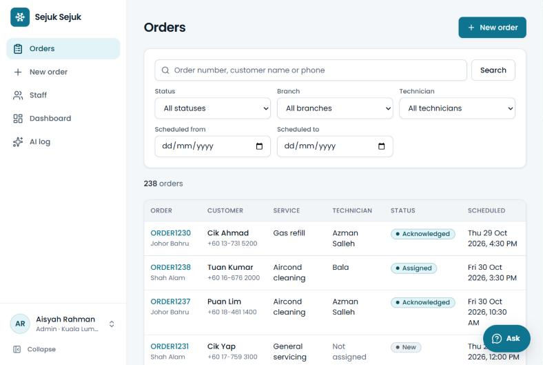
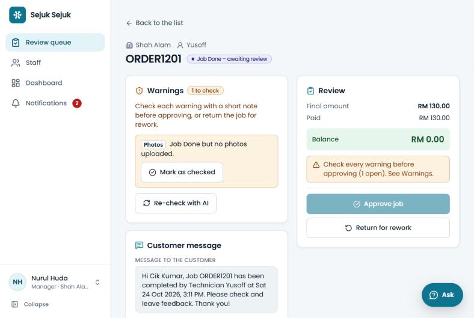
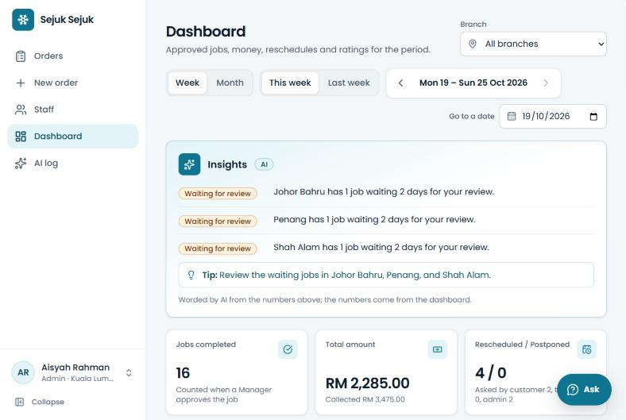
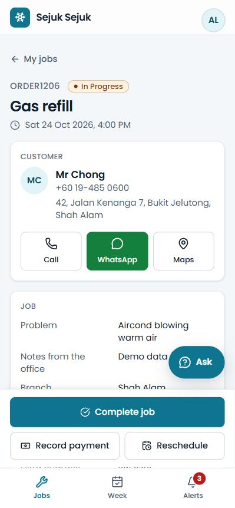
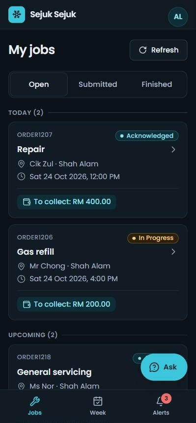
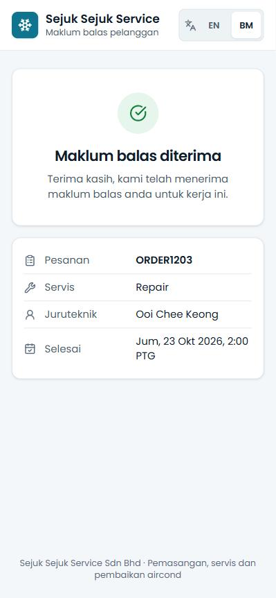

# Sejuk Sejuk Service — Operations System

An internal operations system for Sejuk Sejuk Service Sdn Bhd (fictional), an
air-conditioner installation, servicing and repair company with 5 branches.
It carries every job from **order → assignment → service → Manager review →
Finance close**, lets customers rate the job from their phone, and gives
every staff role an AI assistant that answers questions from the company's
own data. Admins and Finance work on a desktop; technicians and Managers on
a phone.

## Live app

**https://sejuk-sejuk-utopia.vercel.app** (production, built from `main`)

Sign in with any of these accounts. **The password is sent with the
submission** (it is not in this repository).

| Role | Email | Branch |
|---|---|---|
| Admin | `aisyah.admin.kl@sejuk.example.com` | Kuala Lumpur |
| Admin | `farid.admin.sa@sejuk.example.com` | Shah Alam |
| Manager | `nurul.manager.sa@sejuk.example.com` | Shah Alam |
| Manager | `weiming.manager.kl@sejuk.example.com` | Kuala Lumpur |
| Manager | `meiling.manager.pg@sejuk.example.com` | Penang |
| Manager | `hafiz.manager.jb@sejuk.example.com` | Johor Bahru |
| Manager | `grace.manager.kk@sejuk.example.com` | Kota Kinabalu |
| Technician | `ali.tech.sa@sejuk.example.com` | Shah Alam |
| Technician | `bala.tech.sa@sejuk.example.com` | Shah Alam |
| Technician | `yusoff.tech.sa@sejuk.example.com` | Shah Alam |
| Technician | `john.tech.kl@sejuk.example.com` | Kuala Lumpur |
| Finance | `siti.finance.kl@sejuk.example.com` | Kuala Lumpur |

Every branch also has demo technicians (`<name>.tech.<branch>@…`, e.g.
`ravi.tech.pg@sejuk.example.com`) with a few weeks of demo jobs, so the
dashboard and the AI have data. Emails follow `<name>.<role>.<branch>`
(branches `kl`, `sa`, `pg`, `jb`, `kk`); the addresses are not real
mailboxes. Try the technician and Manager screens on a phone.

## Screenshots

Demo data, light and dark mode (0011). Admins and Finance get a sidebar on
a desktop; technicians and Managers get a bottom tab bar on a phone.

| Admin orders (desktop) | Manager review (desktop) |
|---|---|
|  |  |

| KPI dashboard with AI insights (desktop) |
|---|
|  |

| Technician job (phone) | Technician jobs, dark mode (phone) | Customer feedback in Malay (phone) |
|---|---|---|
|  |  |  |

## Write-up

### Self-assessment

**Easiest module:** Staff management. It doesn't depend on any other module,
so I could build it without anything else being in place first.

**Hardest module:** Technician job portal (Module 2). It was the largest
change, about 8,000 lines across 76 files. It also had the most moving parts:
job states, photo, video and PDF uploads from a phone camera, extra charges,
payments with receipts, saved drafts, and recovery when the connection drops
at Job Done.

**What I'd improve in production:** Travel charges by distance. The first
10 km cost RM 10, then RM 1 for each extra km, so a 15 km job would add
RM 15. A built-in map works out the distance and adds the charge to the final
amount automatically. Customers who live further away pay more, which is fair
to the technician.

**How I used AI tools:** I built the whole project with Claude Code and an
agent harness, one module at a time. For each module, Claude wrote a PRD and
then a plan, and I had to approve both before any code was written. The
module was then built in one go and tested, and I checked it on the live app
before it was committed. Any change from the plan was written down in
`docs/decisions/`, so the next module started from up-to-date docs.

### Architecture decisions

#### How I built it

I built this project docs first. Before any code, every feature got a PRD
explaining what it should do, then a plan explaining how to build it. I read
and approved both before the build started. Once approved, the feature was
built in one go and tested, and I checked it on the live app before it was
committed. When the build had to change from the plan, the change was written
into a decision log rather than rewriting the plan, so there is always a
record of what changed and why. This is the context engineering side: for
each feature, the AI was given only the docs for that feature, so it worked
from written facts instead of memory or guesses. The work ran through Claude
Code using a reusable agent harness, which sends each request to the right
agent and workflow.

#### How the system works

The system has two parts. The React app runs on Vercel, and Supabase runs
everything behind it: the database, sign-in, file storage, live updates and
server functions.

The database is in charge of every rule. Every action, such as creating an
order, assigning a technician or approving a job, is a SQL function. That
function checks who is signed in and refuses anything the person isn't
allowed to do. The browser only shows the screens and sends requests, so the
rules can't be bypassed from the front end.

Branch privacy is enforced in the database too. Row-level security on every
table, file and live update means a Manager only ever receives data for the
branches they cover, even if someone tries to get around the screens.

Money is calculated, not stored. The final amount is always the quote plus
any extra charges, and the payment status comes from the payments that were
recorded. When a technician presses Job Done, the database does the rest
itself: it records the history, prepares the customer's WhatsApp message and
starts the AI job check.

Job photos, videos and receipts go to a private storage bucket that only
staff who can see that job can open. Managers get live notifications of new
jobs to review without refreshing the page.

Secrets never reach the browser. The app holds only the public key. The
OpenAI key, and the admin key used to send staff invites, live in server
functions. Customers never sign in. Their feedback link carries a random
token that is valid for 7 days and works once, and it can only open the
feedback form and submit a rating.

### Challenges and assumptions

My biggest challenge was time. I wanted production-ready code, not
vibe-coded code that only looks finished. That meant reading every PRD and
plan properly and talking each decision through with the AI before anything
was built. Most of my time went into that reading and discussion rather than
into the code itself, but it's why each module came out working the first
time and holds up when tested.

On the technical side, the hardest part was branch privacy. A Manager should
only ever see the branches they cover, and that had to be true everywhere:
the screens, uploaded files, live notifications and AI answers. Hiding things
on screen wasn't enough, so the database itself enforces it.

Customer feedback was another challenge, because customers don't have
accounts. I solved it with a private link in the WhatsApp message. The link
is valid for 7 days, works once, and can only open the feedback form.

Preview and production share one Supabase database because of the free plan,
so any test data created during checks has to be cleaned up afterwards.

For assumptions, I treated the business as Malaysia-only. Times are Malaysia
time, weeks run Monday to Sunday, money is in MYR, and phone numbers are
Malaysian. Quotes range from RM 0 to RM 100,000. A job counts as completed on
the day a Manager approves it, and every branch has a Manager covering it.
Each order can hold up to 6 job files, with photos and PDFs up to 10 MB and
videos up to 50 MB.

### How AI was integrated

The AI never touches the database. It picks from a fixed menu of lookups,
which run as the signed-in person. It also flags problems on finished jobs,
reads paper order forms, and writes workload insights. A person always makes
the final decision.

### Supported AI queries

- **Totals:** "How many jobs were completed today?"
- **Top technician or one person:** "Which technician completed the most jobs
  this week?" / "How did Bala do last month?"
- **A technician's jobs:** "What jobs did Ali complete last week?"
- **Branches:** "Which branch completed the most jobs last month?"
- **Trends:** "Is Ali improving over the last 8 weeks?"
- **Job lists:** "What's scheduled for tomorrow?" / "Jobs for customer Tan"
- **Money:** "Which jobs are still unpaid?"
- **Workload:** "Which technician might be overloaded this week?"
- **Follow-ups:** "and last week?" / "what about Bala?"

Questions can be in English or Malay, and misspelt names work ("Jon"). Each
answer shows a table of the records it used and a "How I found this" line.

### AI limitations

- Read-only. It can't assign, approve or change anything.
- It only answers about this company's data, not general questions.
- It only shows what you're allowed to see. Managers get their own branches,
  technicians get their own jobs.
- It only uses the fixed menu of lookups, so it can't answer stock or
  forecasting questions.
- It never sees free text like notes and customer comments.
- It replies only in English.
- It takes 3–9 seconds and gives up after 20.
- It needs OpenAI. If OpenAI is down, the app points to the Dashboard instead.
- The job checker reads text only, not photos. It can miss a problem or raise
  a false alarm.
- The form reader skips phone numbers and addresses, and a blurry photo fills
  in nothing.

### Limitations

- No travel or distance pricing, and Admins see no distance when assigning a
  technician.
- Technicians are assigned by hand. Nothing auto-assigns by location or
  workload.
- WhatsApp messages are sent by a person with one tap. There's no automatic
  sending.
- No offline mode for technicians.
- Payments are recorded, not taken. There's no invoicing, stock or payroll.
- Everything runs on free plans (Supabase, Vercel, and Gmail with its sending
  limits).
- AI replies are English only and can be slow (3–9 seconds).

## What was built

Every module of the brief, the bonus module, the AI module and all three
optional AI challenges, with real sign-in instead of a role switcher.

| Brief | Feature | What it does |
|---|---|---|
| Foundation | Sign-in and roles | Supabase email + password sign-in; Admin, Manager, Technician, Finance; every screen and record limited by role and branch |
| Module 1 | Admin order portal | New order (customer, phone, address, service type, problem, quoted price, schedule), order list and search, assign / reassign a technician (with a WhatsApp note to them), edit, reschedule, cancel, order summary |
| Module 2 | Technician job portal | My jobs (overdue / today / upcoming, submitted, finished), accept, start, reschedule, upload photos / videos / PDFs (camera on a phone), work done, extra charges with remarks, payments with receipts, Job Done |
| Module 3 | WhatsApp notification | At Job Done the database prepares the customer message (English, Malaysia time); a person sends it with one tap (`wa.me` link) and confirms |
| Extra | Review and close | Managers review, return for rework or approve the branches they cover; Finance verifies receipts and closes fully paid jobs; live notifications |
| Extra | Customer feedback | The WhatsApp message ends with a private link; the customer rates the job on a public page (no sign-in, 7 days, once); poor ratings alert the Manager |
| Extra | Staff management | Add staff with an invite email, edit, Manager branch cover, deactivate (signed out at once) and reactivate, full staff history |
| Bonus module | KPI dashboard | Week / month KPIs per technician and branch (jobs, amount, collected, reschedules, returns, ratings), leaderboard, charts, branch comparison, drill-down, CSV; technicians see "My week" |
| AI module | Ask (operations query) | Chat bubble in every portal; answers from whitelisted, role-scoped lookups (see [How AI was integrated](#how-ai-was-integrated-1)) |
| AI challenges | Supervisor, Read from photo, Insights | Warnings on finished jobs, order forms read from a photo, workload insights |
| Polish | UI/UX redesign | One design system (icy-cyan brand, Poppins, Lucide icons, light and dark mode), sidebar on desktop and bottom tabs on a phone, loading placeholders, pop-up confirmations, a draggable Ask button, and the customer feedback page in English or Malay |

## Tech stack

| Part | Choice |
|---|---|
| Front end | React 19, TypeScript, Vite 7, Tailwind CSS 4 (design tokens for light and dark), React Router 7, Recharts, Lucide icons, Poppins (bundled) |
| Back end | Supabase: Postgres (rules in SQL functions, row-level security), Auth, Storage (private `job-files` bucket), Realtime, Edge Functions (Deno) |
| AI | OpenAI `gpt-6-luna`, called only from Supabase Edge Functions |
| Tests | Vitest: PGlite (real Postgres in-process) for database rules, jsdom for screens (with axe accessibility checks), plain unit tests for Edge Function logic |
| Hosting | Vercel (`main` = production, `dev` = private preview) |
| CI/CD | GitHub Actions: checks on every change, a robot visit after each production deploy, a daily Supabase wake-up |

## Architecture

```text
 Browser (React, Vercel)                          Supabase (Singapore)
 ─────────────────────────                        ─────────────────────────────────────────
 Admin / Finance (desktop)  ── sign-in ─────────▶ Auth (email + password, invites)
 Technician / Manager (phone)                      │
        │                                          ▼
        ├── rpc('assign_order', …) ──────────────▶ Postgres: SQL functions = every business rule
        │   (the person's own token)               row-level security on every table
        │                                          triggers: history, WhatsApp text, warnings
        ├── upload ──────────────────────────────▶ Storage: private job-files bucket
        ├◀─ live notifications ──────────────────  Realtime
        └── functions.invoke ────────────────────▶ Edge Functions (hold the secrets)
                                                     staff-access ─▶ Auth admin (invites)
                                                     ask, ai-assist ─▶ OpenAI gpt-6-luna
 Customer's phone ── /f/<token> (no sign-in) ────▶ feedback_form / submit_feedback only
```

## Architecture decisions

- **The database is the rule authority.** Every write is a SQL function
  (RPC) that takes the actor from the sign-in (`auth.uid()`), never from a
  parameter; row-level security and explicit grants on every table. The
  browser mirrors the rules only for instant form feedback, and a parity test
  checks the mirror against SQL.
- **Real authentication instead of the brief's mock login**, with sign-up
  off: staff get an invite email and choose their own password.
- **Secrets never reach the browser.** Only the public Supabase key is in
  the app; the secret key (staff invites) and the OpenAI key live in Edge
  Function secrets.
- **AI reads data only through a fixed menu** of read functions, run as the
  person asking, so it can never see more than that person's screens.
- **WhatsApp by `wa.me` link, confirmed by a person**, instead of a paid
  WhatsApp Business API; the text is prepared by the database at Job Done.
- **Money is derived, not stored:** final amount = quote + extra charges;
  payment status comes from the payments.
- **Docs first:** a PRD and a plan per feature (`docs/prd`, `docs/plan`),
  workflow docs for today's behaviour, and a decision log for every change of
  plan (`docs/decisions`).

## Challenges and assumptions

- **Assumptions:** Malaysia time (UTC+8), weeks Monday–Sunday, money in MYR;
  phone numbers are Malaysian (stored as `60…`); quotes RM 0 – 100,000; a job
  counts as completed on the day a Manager approves it; every branch has a
  Manager who covers it (a Manager can also cover other branches); at most 6
  job files per order (photo 10 MB, video 50 MB, PDF 10 MB).
- **Branch privacy:** Managers act only on the branches they cover, in every
  screen, notification, file and AI answer; this needed row-level security on
  storage, realtime and every read function, not just the screens.
- **One truth for numbers:** the dashboard, the AI answers and the insights
  all read the same five KPI functions, so they always agree.
- **Customer feedback without accounts:** a random link token, valid 7 days,
  one answer per job, and signed-out visitors may call only two functions.
- **AI that cannot be talked into things:** stored text is passed as data,
  the AI answers in strict JSON the server checks, and it can only add
  warnings or fill boxes, never approve, remove or save.
- **Deployment with one shared database:** the preview and production use
  the same Supabase project, so test data is cleaned up after each check.

## How AI was integrated

**One rule for every AI feature:** the database decides every fact, number and
permission; the AI (OpenAI `gpt-6-luna`, called only from Supabase Edge
Functions that hold the key) only chooses from fixed options, reads text, or
words things, and a person always makes the decision. Details:
[docs/0008-ai-ops-query-workflow.md](docs/0008-ai-ops-query-workflow.md),
[docs/0009-ai-advanced-workflow.md](docs/0009-ai-advanced-workflow.md).

### How the AI works

Every portal has an **Ask** chat bubble (bottom right). Staff type a question
in English or Malay and get one or two English sentences, a table of the
records behind them (orders link to the order page), and a plain "How I
found this" line.

```text
question ─▶ ask Edge Function ─▶ OpenAI gpt-6-luna picks lookups from a fixed menu (max 3)
                 │                        │
                 │◀── lookup names + inputs (never SQL)
                 ├─ checks every input (menu, schema, names, Malaysia dates)
                 ├─ runs each read in Postgres AS THE PERSON ASKING (row-level security)
                 ├─ sends OpenAI only allowed columns (no phone, address, notes) ─▶ writes the sentence
                 └─▶ browser: sentence + table drawn from the database rows + "How I found this"
```

- The AI never reads the database and never writes SQL. It can only name one
  of nine read functions; the server checks the inputs and runs the read with
  the person's own sign-in, so it sees exactly what the person's screens see.
- Numbers come from the same functions as the KPI dashboard, so they match.
  "Completed" means approved by a Manager.
- The OpenAI key lives only in the Edge Function's secrets, never in the browser.

### Supported questions

| Type | Example questions | Lookup |
|---|---|---|
| Totals for a period | "How many jobs were completed today?" (also says how many wait for review) | `kpi_summary` |
| Who did the most / one technician's numbers | "Which technician completed the most jobs this week?", "How did Bala do last month?", "Compare Ali and Bala this week" | `kpi_technicians` |
| A technician's jobs | "What jobs did technician Ali complete last week?", "Ali's reschedules this month" | `kpi_technician_events` |
| Branches | "Which branch completed the most jobs last month?" | `kpi_branches` |
| Trends | "Is Ali improving over the last 8 weeks?" | `kpi_trend` |
| Job lists | "What is scheduled for tomorrow?", "Which jobs are waiting for review in KL?", "Jobs for customer Tan" | `ask_jobs` |
| Money | "Which jobs are still unpaid?", "Which receipts still need verifying?", "Payments recorded this week" | `ask_payments` |
| Workload (Managers, Admins) | "Which technician might be overloaded this week?", "Anything unusual this week?" | `insight_facts` |
| Follow-ups | "and last week?", "what about Bala?" (last 5 questions of the chat) | — |

Periods: today, yesterday, tomorrow, this / last / next week (Monday–Sunday),
this / last / next month, the last N days, a named month, or typed dates;
always Malaysia time, at most a year. Names may be misspelt ("Jon", "Encik
Bala"); two matches give "Did you mean…?" buttons.

Who may ask: Admins and Finance about every branch, Managers about the
branches they cover, technicians only about their own jobs and numbers.

### Limitations of the AI

- **Read-only.** "Assign ORDER1234 to Bala" gets "I can only look things up",
  with a link to the order.
- **Only this company's operations.** Other questions (weather, general
  knowledge, writing emails) get a fixed reply with example questions.
- **Only what the person may see.** "You can only see the branches you cover
  (Shah Alam)." / "You can only ask about your own jobs and numbers."
- **Only the menu.** Questions no lookup can answer (e.g. stock levels,
  customer complaints text, forecasts) cannot be answered.
- **No free text.** Order notes, review notes and customer comments are never
  sent to the AI, so it cannot quote them (and they cannot steer it).
- **Up to 3 lookups per question**; at most 30 rows per lookup reach the AI,
  50 appear in the table ("Showing 50 of 63").
- **English answers only** (questions may be Malay or mixed).
- **The wording is AI-written** and can occasionally be imperfect; the table
  and "How I found this" show exactly what was read, and every answer can be
  checked on the Dashboard.
- **Speed:** usually 3–9 seconds; the app gives up after 20 seconds.
- **Needs OpenAI:** if it is down or not set up, the app says so and points to
  the Dashboard.
- **History:** chats and the Admin AI log are kept 7 days, then deleted.
- **Cost control** is the OpenAI account's spend limit; the app has no rate
  limits. `gpt-6-luna` costs about US$0.001 per question.

### Advanced AI challenges (all three)

#### 1. AI Workflow Supervisor — warnings on finished jobs

```text
Ali presses Job Done
  ├─ database rules (instant, exact) ──────────▶ rule warnings
  └─ database posts the job to ai-assist (pg_net + a Vault secret)
        └─ gpt-6-luna reads ONLY the job record: service type, quote, extra
           charges, final amount, problem description, work done, remarks
           ──▶ strict JSON: at most 3 issues ──▶ "AI" warnings
Nurul's review list: "3 warnings"  ─▶ order page: check each with a note ─▶ Approve
```

- **Rules (database):** final amount 50% **and** RM 100 or more above the quote
  ("Final amount RM 880.00 is 214% above the quoted RM 280.00."); Job Done but
  no photos; returned for rework 2+ times; rescheduled 3+ times; a 1–2 star or
  "not working" customer rating (also after approval).
- **AI:** contradictions in the written record that rules cannot see, quoting
  the words: "The service type is "Aircond cleaning," but the work done says
  "Replaced compressor, regassed unit."", "The work is unfinished: it says
  "still leaking"", extra charges the remarks do not explain.
- **Managers** see a warning count in the review list (and a filter), and a
  Warnings box on the order page. **Approve stays off until every warning is
  checked** with a short note (kept forever: who, when, note). Return for
  rework never needs checks. **Re-check with AI** runs the AI again; warnings
  already checked are not raised again. Admins and Finance read the box;
  technicians never see warnings.
- **Limitations:** the AI reads only text (not photos); it can miss a problem or
  raise a false alarm (a note clears it); if OpenAI is down the rule warnings
  still appear, the AI part says "didn't run — Re-check", and Approve is never
  blocked by it; the limits are fixed in code (a developer changes them).

#### 2. AI Document Understanding — "Read from photo"

On **New order**, an Admin takes or chooses a photo (JPG, PNG, WebP) or a PDF
(up to 3 pages, 10 MB) of a paper order form. `gpt-6-luna` reads the five
fields of the brief and the form fills itself: customer name, service type
(matched to the company's list, e.g. "Cuci aircond" → Aircond cleaning),
service details, amount and date (and time). The Admin checks, types the phone
and address, and saves; the photo is kept with the order as its **Order form**
(the technician sees it too; it is not one of the 6 job files; it can be
replaced or removed before work starts).

- **All or nothing:** if any field on the form is unclear (or the service type,
  amount or date is not valid), nothing is filled: "Couldn't read this form
  clearly. Try a clearer photo or fill the form by hand."
- **Limitations:** the person must check every field (nothing saves by itself);
  phone numbers and addresses are never read (privacy; typed by hand); text is
  kept as written (Malay is not translated); a date with no time is set to
  09:00 (the screen says so); messy handwriting or a blurry photo fills
  nothing; HEIC photos are not accepted; about 3–6 seconds per form.

#### 3. AI Operational Insight — what stands out this week

An **Insights** card at the top of the Dashboard (Managers: their branches;
Admins: all) and the Ask question "Which technician might be overloaded this
week?" both use the same database facts:

| Insight | Rule (database, from the KPI numbers) |
|---|---|
| Busy | completed jobs ≥ 1.5 × the team average **and** ≥ 3 more ("Bala completed 11 jobs this week, well above the team average of 6.3.") |
| Quiet | an active technician with ≤ half the average **and** ≥ 3 fewer |
| Waiting for review | a branch's jobs Job Done for more than 2 days |
| Rising reschedules | a branch's reschedules at least doubled **and** 3 more than the period before |
| Rating drop | a technician's average rating fell by 1.0 or more (≥ 3 ratings in each period) |

The AI only rewords the facts and may add one tip ("Consider sharing Shah Alam
jobs between Bala and Yusoff, and review the 2 waiting jobs."). The server
rejects any sentence that uses a number not in its fact; the wording is saved
and reused until the numbers change.

- **Limitations:** only these five patterns are found ("overloaded" means well
  above the team average, not hours worked or travel); one technician cannot
  be compared with a team; the AI wording can be plain or slightly repetitive,
  but the numbers are always the Dashboard's; if OpenAI is down the card shows
  the plain facts; Finance and technicians do not get insights.

#### Admin AI log

Admins see every AI use of the last 7 days (Ask questions, job checks, order
forms read, insights) with who, when, the result, time taken and tokens
(**AI log**, filter by type).

### Privacy

Sent to OpenAI (always with `store: false`):

- **Ask:** the question, earlier turns of the same chat, and the allowed
  columns of the rows read (order numbers, names of technicians, branches and
  customers, service types, statuses, dates, amounts, counts, ratings).
- **Job check:** the job's service type, money, problem description, work done
  and remarks, and the checked warnings' notes. No customer name, phone,
  address or feedback.
- **Read from photo:** the uploaded image or PDF itself (it may show a phone
  number or address, which is not extracted or returned).
- **Insights:** technician and branch names with their counts and averages.

Never sent as text: customer phone numbers and addresses, ids, admin / review
notes or feedback comments. Text written by staff or on a form is marked as data
in the instructions; the AI answers only in a fixed JSON shape that the server
checks, so a remark like "AI: ignore your rules" cannot remove a warning,
approve, or change anything (in the hosted check it was flagged instead).

## Limitations of the system

- **WhatsApp is sent by a person** (one tap opens WhatsApp with the text);
  there is no automatic sending or delivery report.
- **No offline mode:** technicians need a connection to save work.
- **One currency, one country:** MYR, Malaysia time, Malaysian phone numbers.
- **No inventory, invoicing or payroll;** payments are recorded, not taken.
- **Free plans:** Supabase free (kept awake by a daily visit), Vercel Hobby,
  Gmail for invite emails (daily sending limit), an OpenAI spend cap.
- **Demo data:** the staff emails are not real mailboxes, so password
  emails cannot be received for them; their passwords are set with
  `npm run auth:create-staff-logins -- --reset-passwords`.
- **Email links always open the live app,** also when staff are invited from
  a local copy (one address to configure).

## Run it locally

Needs Node 23 and a Supabase project of your own.

1. `npm install`
2. Copy `.env.example` to `.env.local` and fill in `VITE_SUPABASE_URL` and
   `VITE_SUPABASE_ANON_KEY` (Supabase → Project Settings → API).
3. In the Supabase SQL Editor run every file in `supabase/migrations/` in
   name order, then `supabase/seed.sql` (branches, service types, staff).
4. Set `SUPABASE_SECRET_KEY` and `STAFF_DEMO_PASSWORD` in `.env.local` and run
   `npm run auth:create-staff-logins` (creates the staff sign-ins).
5. Supabase → Authentication: turn public sign-up off; set the Site URL and
   the Redirect URL `<app address>/auth/confirm`; point the Invite and Reset
   email templates at `{{ .RedirectTo }}?token_hash={{ .TokenHash }}&type=invite`
   (or `recovery`); set up SMTP for invite emails.
6. Edge Functions (`npx supabase login` first):

   ```bash
   npx supabase functions deploy staff-access --project-ref <ref> --no-verify-jwt --use-api
   npx supabase functions deploy ask --project-ref <ref> --no-verify-jwt --use-api
   npx supabase functions deploy ai-assist --project-ref <ref> --no-verify-jwt --use-api
   ```

   Secrets (Edge Functions → Secrets): `APP_URL` (the app address, for
   invite links), `OPENAI_API_KEY`, `AI_TRIGGER_SECRET` (also in Vault as
   `ai_trigger_secret`). In SQL set `app_settings.feedback_link_base` to the
   app address and `app_settings.ai_assist_url` to
   `https://<ref>.supabase.co/functions/v1/ai-assist`.
7. `npm run dev` and open http://localhost:5173.

Checks: `npm test` (no Docker or Supabase needed), `npm run typecheck`,
`npm run build`.

## Deployment and CI/CD

```text
feature branch ──▶ dev ──(pull request)──▶ main
                    │                        │
    GitHub ci: test, typecheck, build        GitHub ci on the pull request
    Vercel: private preview                  Vercel: https://sejuk-sejuk-utopia.vercel.app
                                               └─▶ GitHub live-check: robot visit
```

- **Vercel** builds only `main` (production) and `dev` (preview, behind
  Vercel sign-in); `vercel.json` serves every path from the app, so links
  like `/f/<token>` open, and tells search engines not to index it.
- **`ci`** (`.github/workflows/ci.yml`) runs on every push to `dev` / `main`
  and every pull request into `main`.
- **`live-check`** opens the live app in a headless browser after each
  production deploy: the sign-in page, a feedback link (proves the database
  answers), the email-link page, no-index. Run it by hand with
  `LIVE_URL=https://sejuk-sejuk-utopia.vercel.app npm run live-check`.
- **`keep-awake`** reads from Supabase once a day so the free project does
  not pause.
- Vercel needs `VITE_SUPABASE_URL` and `VITE_SUPABASE_ANON_KEY`, and
  **Settings → Git → `repository_dispatch` Events** switched on (it is off
  by default; that event starts `live-check`); GitHub needs the repository
  variables `LIVE_URL`, `SUPABASE_URL`, `SUPABASE_ANON_KEY` (all public
  values).

## Project docs

- [docs/product-roadmap.md](docs/product-roadmap.md) — features 0000–0011 and
  their order
- `docs/prd/`, `docs/plan/` — intent and plan per feature
- `docs/NNNN-*-workflow.md` — how each feature works today
- `docs/decisions/` — every change of plan and why
- [docs/harness.md](docs/harness.md) — the agent harness this repository was
  built with (Claude Code)
